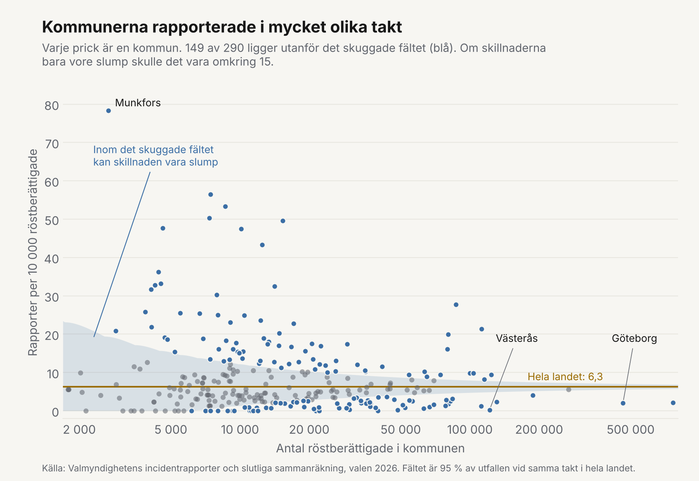

# Valkoll addition

A statistical review of Valkoll's analysis of the incident reports from the Swedish elections of 2026. [Valkoll](https://valkoll.com/incidentrapporter/) is an independent project by Victor Pressfeldt that classified the 5,194 reports Valmyndigheten (the Swedish Election Authority) received from the election administration. This repository checks the published figures against the source data and adds the uncertainty and significance tests the page does not report.

The analysis can strengthen or weaken Valkoll's conclusions, and both directions are reported.

## Results

**1. The kommun map mostly measures how willing each kommun was to report.** If every kommun reported at the national rate (6.31 per 10,000 eligible voters), about 15 of 290 would fall outside the 95 % limits by chance. 149 do. The variance between kommuner is about 23 times what chance gives (Pearson dispersion 22.96), and small kommuner report more per voter than large ones (size elasticity -0.24, 95 % CI -0.36 to -0.12). Västerås would have had about 77 reports at the national rate and has 3.



**2. Reports describe V as disadvantaged far more often than chance explains; SD's excess of favoured reports is within chance.** Testing each party's share of "favoured" reports against 0.5 (exact binomial test):

| Party | Favoured | Disadvantaged | Share favoured | 95 % CI | p |
|---|---|---|---|---|---|
| V | 76 | 188 | 0.29 | 0.23 to 0.35 | 4e-12 |
| SD | 261 | 226 | 0.54 | 0.49 to 0.58 | 0.12 |

SD is the only riksdag party above zero, as the page says, but the difference from 50/50 is within chance. A fairer reference than 50/50 is the other parties' share, since most parties are below zero; against that, SD's excess could turn out stronger. That test needs report-level data.

**3. Valkoll's figures hold against the source, with differences that can be explained.** Every published kommun figure is reproduced exactly, and eligible voters match Valmyndigheten's final count for all 290 kommuner. The incident report file obtained from Valmyndigheten is a later version than Valkoll's (5,258 reports up to 7 October, against 5,194 up to 28 September). For Valkoll's period it holds 14 more reports, most likely registered afterwards. Two categories and the 26 withheld reports match exactly. Applying Valkoll's published duplicate definition gives 46 likely duplicates instead of 38; all of them are double submissions with identical receipt times.

The validation Valkoll reports (100 of 100 rows with the right party) bounds the party error at about 3 % only for a simple random sample, and 90 of the 100 rows were drawn from selected groups. It does not test the direction of each report (favoured or disadvantaged), which is what decides the party totals.

## Pipeline

| Step | What it does | Output |
|---|---|---|
| `00_fetch_valkoll_kommun_table.py` | Parses Valkoll's per-kommun table and validates that each published rate follows from its counts | `data/processed/kommun_report_rates.parquet` |
| `01_ingest_eligible_voters.py` | Reads eligible voters from Valmyndigheten's final count and compares with Valkoll | `outputs/01_eligible_voters_check.md` |
| `01_ingest_reports.py` | Reads and validates the incident report file; counts compared with Valkoll | `outputs/01_reports_check.md` |
| `02_clean_dedup.py` | Removes test reports and likely duplicates by Valkoll's definition | `outputs/02_clean_dedup.md` |
| `05_tests_published.py` | Exact binomial tests on the published party counts | `outputs/05_tests_published.md` |
| `08_reporting_rate_model.py` | Dispersion test, funnel plot, negative binomial with size, empirical Bayes shrinkage per kommun | `outputs/08_*` |
| `12_publication_figure.py` | The reporting-rate figure for a general reader, in Valkoll's light and dark styles | `outputs/12_*.png` |

Reports in `outputs/` are written in Swedish, as is the source material.

## Data

| Source | How it is obtained | Check |
|---|---|---|
| Valkoll, incident report page | Per-kommun table parsed into `data/processed/` (read 9 October 2026) | Every row validated |
| Valmyndigheten, incident reports 2026 | Requested as a public document (allmän handling) | SHA-256 in `config.yaml` |
| Valmyndigheten, votes per district, riksdag 2026 | [val.se raw data](https://www.val.se/valresultat-och-statistik/statistik-och-data/radata-val-2026) | SHA-256 in `config.yaml` |

The incident reports contain free text. The file is never committed, the text is never sent to an external service or language model, and nothing in this repository quotes it; reports are referred to by row number only. Valmyndigheten has already replaced personal data with `[Personinformation]`.

## Running it

Python 3.12 with [uv](https://docs.astral.sh/uv/).

```bash
uv sync
uv run python pipeline/05_tests_published.py
uv run python pipeline/08_reporting_rate_model.py
uv run python pipeline/12_publication_figure.py
```

These three run on the committed tables in `data/processed/`. Step 00 fetches Valkoll's page again and rebuilds the kommun table. The steps that read Valmyndigheten's files need the files placed at the paths in `config.yaml`. Each step checks the file hash and stops if it differs.

## Open questions

- Which three reports Valkoll counted as test reports (this review finds four) and whether its text comparison for duplicates differs from the published description.
- Report-level tests for all eight riksdag parties, with a cluster bootstrap for reports that involve more than one party, and a blind validation of the favoured/disadvantaged classification with Cohen's kappa. Both need Valkoll's classification.

## Licence

Code: MIT, see `LICENSE`. Figures and reports in `outputs/`: CC BY 4.0, see `outputs/LICENSE.md`. Data: Valmyndigheten.
